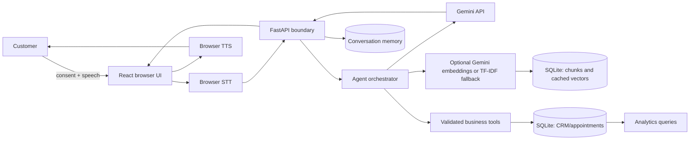

# Architecture

The browser is the microphone/audio security boundary; raw audio is not uploaded or retained. CORS restricts the local API origin. FastAPI/Pydantic validate ingress, SQLAlchemy parameterizes storage, and the Gemini adapter receives bounded history plus retrieved context. Retrieved text is explicitly treated as data rather than instructions. SQLite supports the laptop demonstration; production replaces it with PostgreSQL and a managed vector store.
